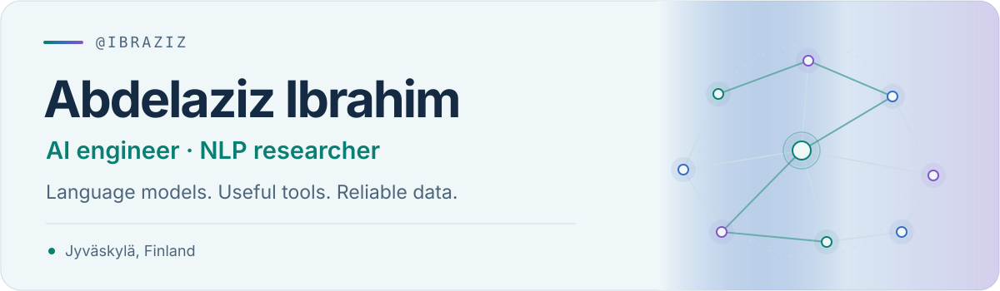

<picture>
  <source media="(max-width: 600px) and (prefers-color-scheme: dark)" srcset="./assets/hero-mobile-dark.svg">
  <source media="(max-width: 600px) and (prefers-color-scheme: light)" srcset="./assets/hero-mobile-light.svg">
  <source media="(prefers-color-scheme: dark)" srcset="./assets/hero-dark.svg">
  <source media="(prefers-color-scheme: light)" srcset="./assets/hero-light.svg">
  
</picture>

  <a href="https://www.linkedin.com/in/abdelaziz-ibrahim-740800172/">LinkedIn</a>

## Hi👋

🔬 Currently Interested in Agent workflows, and Multi-Agent Systems.
👯 looking to collaborate on NLP projects, and any other AI-related projects.

## Tools & frameworks

<!-- tools:start -->

| Area | Tools & frameworks |
| :--- | :--- |
| **Programming** |      |
| **AI & NLP** |      |
| **LLMs & agents** |    |
| **APIs & applications** |      |
| **Data & databases** |       |
| **Vector search** |   |
| **HPC & containers** |      |
| **Knowledge graphs** |    |
| **Cloud & dev tools** |    |

<!-- tools:end -->
