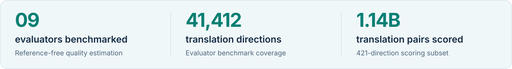
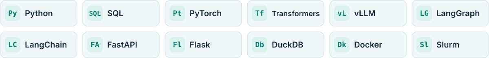

<picture>
  <source media="(max-width: 600px) and (prefers-color-scheme: dark)" srcset="./assets/hero-mobile-dark.svg">
  <source media="(max-width: 600px) and (prefers-color-scheme: light)" srcset="./assets/hero-mobile-light.svg">
  <source media="(prefers-color-scheme: dark)" srcset="./assets/hero-dark.svg">
  <source media="(prefers-color-scheme: light)" srcset="./assets/hero-light.svg">
  
</picture>

  <a href="https://www.linkedin.com/in/abdelaziz-ibrahim-740800172/">LinkedIn</a>
  &nbsp;·&nbsp;
  <a href="https://arxiv.org/abs/2606.00285">Research paper</a>
  &nbsp;·&nbsp;
  <a href="https://github.com/Ibraziz?tab=repositories">Repositories</a>

## Hi, I'm Abdelaziz 👋

I'm an AI engineer based in Jyväskylä, Finland, with a master's degree in Artificial Intelligence from the University of Jyväskylä. I build LLM applications, agent workflows, and data pipelines, with a particular interest in multilingual NLP and model evaluation.

I like learning through implementation: working through the details, understanding why something fails, and making it work reliably.

## Selected work

### 01 / [FineOPUS](https://github.com/MaLA-LM/FineOPUS/tree/main/05_quality_estimation) · Multilingual data quality

I built the quality-estimation stage of FineOPUS as part of my master's thesis with the MaLA team. My work covered evaluator benchmarking, model selection, and scalable scoring and filtering on the Mahti and LUMI supercomputers.

<picture>
  <source media="(max-width: 600px) and (prefers-color-scheme: dark)" srcset="./assets/research-mobile-dark.svg">
  <source media="(max-width: 600px) and (prefers-color-scheme: light)" srcset="./assets/research-mobile-light.svg">
  <source media="(prefers-color-scheme: dark)" srcset="./assets/research-dark.svg">
  <source media="(prefers-color-scheme: light)" srcset="./assets/research-light.svg">
  
</picture>

The pipeline includes validated model outputs, selective retries, resumable checkpoints, and streaming Parquet processing. I also co-authored [Model-Based Quality Assessment for Massively Multilingual Parallel Data](https://arxiv.org/abs/2606.00285).

**Built with:** Python · PyTorch · vLLM · Slurm · DuckDB · Parquet · Apptainer

[Pipeline code ↗](https://github.com/MaLA-LM/FineOPUS/tree/main/05_quality_estimation) &nbsp; [Filtered dataset ↗](https://huggingface.co/datasets/MaLA-LM/FineOPUS-Filtered-Stage5)

### 02 / [SQL Data Analytics Agent](https://github.com/Ibraziz/DataAnalystAgent) · Questions into queries

I built an agent that turns natural-language questions into SQL, database results, explanations, and interactive charts. It inspects database schemas and uses SQL tools through a bounded agent loop, with chart validation before returning visualizations.

🏆 **SmartBi challenge winner — AaltoAI Hackathon 2025**

**Built with:** Python · Gemini · LangGraph · LangChain · Flask · SQLite · Chart.js

### 03 / [Lawgic](https://github.com/bikhanal/lawgic) · Working with legal documents

I contributed to a legal-document application with OCR, retrieval-augmented chat, structured contract extraction, translation, and EU legislation search. The work included document-aware retrieval, structured outputs, and EUR-Lex integration.

**Built with:** FastAPI · Pydantic · Chroma · Hugging Face embeddings · SQLAlchemy

## Languages and tools

<picture>
  <source media="(max-width: 600px) and (prefers-color-scheme: dark)" srcset="./assets/tools-mobile-dark.svg">
  <source media="(max-width: 600px) and (prefers-color-scheme: light)" srcset="./assets/tools-mobile-light.svg">
  <source media="(prefers-color-scheme: dark)" srcset="./assets/tools-dark.svg">
  <source media="(prefers-color-scheme: light)" srcset="./assets/tools-light.svg">
  
</picture>

| Area | What I work with |
| :--- | :--- |
| **AI and applications** | LLM evaluation, RAG, agent workflows, PyTorch, Transformers, vLLM, LangChain, LangGraph, FastAPI, Flask |
| **Data** | Python, Oracle SQL, PostgreSQL, DuckDB, SQLite, Parquet |
| **Infrastructure** | Slurm, Docker, Apptainer, CUDA and ROCm environments |
| **Knowledge graphs** | RDF, SPARQL, ontologies — grounded in coursework and project work |

## A little more about me

- **Research:** multilingual translation quality, evaluator selection, and reliable data processing.
- **Teaching:** previously taught NLP, machine learning, and evolutionary algorithms at Helwan University.
- **Earlier work:** Oracle SQL reporting and application troubleshooting as a database specialist.
- **Languages:** Arabic (native), English (fluent), Finnish (beginner).

I'm interested in building useful AI applications and collaborating on NLP, retrieval, and data projects. You can reach me on [LinkedIn](https://www.linkedin.com/in/abdelaziz-ibrahim-740800172/).
